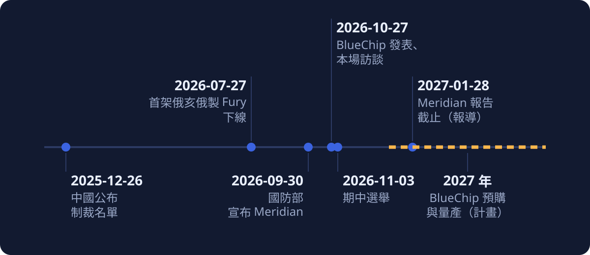

<!-- layout: cover -->
# 九成來自美國與盟友，面板還在海外：Luckey 談 BlueChip 美國製筆電

影片：[Bloomberg Tech 專訪 Palmer Luckey（YouTube，14:43）](https://www.youtube.com/watch?v=a2wv9giz3vU)。本簡報的時間點（如 [04:12](https://www.youtube.com/watch?v=a2wv9giz3vU&t=252s)）都指這支影片，可點開對照；也有[雙語字幕播放器](player.html)與[全文譯本](translation-zh.html)。

> 本導讀的分析與撰稿由 AI 模型完成，不是人類分析，也沒有經過人工逐句校稿；依 YouTube 機器字幕製作，未對照原音。模型分工見文末〈製作說明〉，重要說法都附來源連結，請以來源為準。

---

<!-- layout: stat -->
## 一台筆電，只有九成

**90%**

主持人開場說這是「100% 美國製造電腦」（[04:12](https://www.youtube.com/watch?v=a2wv9giz3vU&t=252s)）。Luckey 說目前整機大約九成來自美國及其盟友，面板在「另一個國家」製造；他說有「明確達到 100% 美國本土製造的技術藍圖」（[07:16](https://www.youtube.com/watch?v=a2wv9giz3vU&t=436s)）。

---

## 三十秒版：他想說的五件事

- 國家最關鍵的系統不該跑在最大戰略對手做的電腦上，所以 Anduril 自己做了 BlueChip。
- 先賣給政府與關鍵產業；軍規做得到，其他人的需求就綽綽有餘。
- 美國的半導體補貼只補到晶片，把晶片封裝、做成產品的環節沒人能做。
- 現況約九成來自美國及盟友，面板在另一個國家；他說有 100% 的技術藍圖，但還不能說是哪家公司。
- 他自己被中國制裁，正因如此 Anduril 早已學會不靠中國；他共同主持的 Meridian 要看未來戰爭，他對採購的看法是快買、不再有用就停。

他的說法與現況有出入的地方，集中放在第二幕。

---

## 這場訪談是直播，字幕是機器聽的

| 項目 | 內容 |
|---|---|
| 節目 | Bloomberg Tech，主持人 Ed Ludlow；2026-10-27 播出，片長 14 分 43 秒 |
| 受訪者 | Palmer Luckey，Anduril 創辦人 |
| 時間點 | 期中選舉（2026-11-03）前一週 |
| 字幕 | YouTube 自動字幕，無說話者標記，未對照原音 |

第一幕整理 Luckey 在訪談裡說的話；第二幕集中對照文件與報導，並用下面的標示說明可信度：

- （已確認）有官方或一手文件，且與說法吻合
- （當事方自揭）只有 Luckey 或 Anduril 自己說
- （單方說法）只有單一來源
- （有爭議）來源之間互相衝突
- （部分確認）只有一部分有來源支持
- （未找到）找不到出處
- （有落差）與來源的內容不同
- （本文歸納）本文自己的整理與判斷

---

<!-- layout: section -->
## 第一幕：Luckey 想說的事

依主題整理他的主張，時間點可點開對照。

---

## 他說做電腦，是為了不依賴最大的戰略對手

- 他舉軍方、醫院、發電廠為例，說很多人打造的東西跑在中國製造的電腦上；讓整個國家最關鍵的經濟命脈依賴最大的戰略對手，「簡直是瘋了」（[00:55](https://www.youtube.com/watch?v=a2wv9giz3vU&t=55s)）。
- Anduril 原本沒打算做電腦；先找別人投資沒成功，因為他「不能去做銷售受中國設備控制的自主武器這種生意」（[01:09](https://www.youtube.com/watch?v=a2wv9giz3vU&t=69s)），最後自己出錢。
- 他說他們要「把矽帶回矽谷」，與美國最頂尖的公司合作，打造從晶片、玻璃、金屬、電池到塑膠「所有的一切」都是美國製造的電腦（[01:20](https://www.youtube.com/watch?v=a2wv9giz3vU&t=80s)、[01:21](https://www.youtube.com/watch?v=a2wv9giz3vU&t=81s)、[01:31](https://www.youtube.com/watch?v=a2wv9giz3vU&t=91s)）。
- 本文歸納：**BlueChip 先是 Anduril 自己用得上的東西**，才談得上是商品。

---

## 先賣政府與關鍵產業

- 先從軍用開始，因為散熱、防震、防水防塵與安全性的要求最嚴苛；「如果我能造出一台符合軍方需求的電腦，要滿足其他所有人的需求就綽綽有餘」（[02:00](https://www.youtube.com/watch?v=a2wv9giz3vU&t=120s)）。
- 目前專注政府，接著是處理機密資料的國防公司與電網等關鍵產業，他們「不能讓外國對手在他們的機器中植入後門」（[02:34](https://www.youtube.com/watch?v=a2wv9giz3vU&t=154s)）。

---

## 他說：補貼只補到晶片，沒人能做成產品

- 「高通已經宣布他們將在亞利桑那州製造晶片」（[03:20](https://www.youtube.com/watch?v=a2wv9giz3vU&t=200s)）。
- 但光有晶片不夠：美國對半導體的補貼與投資，「我們根本沒有任何能力去封裝它們，並將它們轉化為有用的產品」（[03:27](https://www.youtube.com/watch?v=a2wv9giz3vU&t=207s)）。
- 「從某種角度來看」，美國的半導體補貼實際上只是在補貼中國製造的筆記型電腦，因為晶片都是送到那裡才被做成產品的（[03:37](https://www.youtube.com/watch?v=a2wv9giz3vU&t=217s)）。

---

## 他說：分析師的天價估算，是在替外包的大企業維持現狀

- 他先說自己的看法比幾乎任何人都更務實（[04:36](https://www.youtube.com/watch?v=a2wv9giz3vU&t=276s)）。
- 分析師說美國製 iPhone 要 37,000 美元、美國電腦要 100,000 美元，他認為這是問題之一，是在替想繼續外包的大企業維持現狀（[04:40](https://www.youtube.com/watch?v=a2wv9giz3vU&t=280s)）。
- 他說「我們不會再任由別人對美國能做什麼和不能做什麼說謊了」（[05:40](https://www.youtube.com/watch?v=a2wv9giz3vU&t=340s)）。

---

## 他說：現在約九成來自美國與盟友，面板還在海外

*圖：依 Luckey 自述整理，計算方式未說明。*

> 重點：90% 是「美國及其盟友」，不是美國；Luckey 自己也把 100% 美國製造當作目標（[01:21](https://www.youtube.com/watch?v=a2wv9giz3vU&t=81s)），九成只是現況。

---

## 他說：100% 只有「技術藍圖」，沒有日期，廠商也還不能說

- 主持人問：在零組件與原物料層面，把對中國的依賴降到 0，有可能嗎？（[04:23](https://www.youtube.com/watch?v=a2wv9giz3vU&t=263s)）面板與 90% 是回答稍後另一題「你要說服誰在美國製造顯示器」（[06:35](https://www.youtube.com/watch?v=a2wv9giz3vU&t=395s)、[07:00](https://www.youtube.com/watch?v=a2wv9giz3vU&t=420s)）。
- 官方答案是 2027 年公布更多，他希望在 CES 能有進展可以宣布；目前和多家廠商洽談，已有計畫（[06:45](https://www.youtube.com/watch?v=a2wv9giz3vU&t=405s)）。
- 他說有「明確達到 100% 美國本土製造的技術藍圖」，但還不能說是哪家公司，因為還在協商（[07:16](https://www.youtube.com/watch?v=a2wv9giz3vU&t=436s)、[07:22](https://www.youtube.com/watch?v=a2wv9giz3vU&t=442s)）。

---

<!-- layout: statement -->
## 他的類比：無人機就是電腦

「Anduril 攻擊型無人機和筆記型電腦唯一的差別就只在於鍵盤和螢幕」（[05:28](https://www.youtube.com/watch?v=a2wv9giz3vU&t=328s)）

---

## 他的本錢：無人機的整合經驗，加上軟體團隊

- 他說自己每天都在美國製造東西，Anduril 的無人機基本上就是電腦，有記憶體、GPU、CPU、感測器、電池與強固設計（[05:20](https://www.youtube.com/watch?v=a2wv9giz3vU&t=320s)、[05:22](https://www.youtube.com/watch?v=a2wv9giz3vU&t=322s)）。
- 主持人問 Lattice 與製造怎麼平衡；Luckey 說 Anduril 做軟體的人比所有硬體產品團隊加起來還多（[08:07](https://www.youtube.com/watch?v=a2wv9giz3vU&t=487s)），Lattice 是驅動戰鬥機、潛艦與飛彈的 AI 大腦（[08:13](https://www.youtube.com/watch?v=a2wv9giz3vU&t=493s)）。
- 這台筆電不能只跑 Microsoft Office 和 Gmail，要相容許多 2000 年代、90 年代甚至 80 年代設計的政府舊應用程式，需要驅動程式介接已有數十年的舊系統，「這需要大量的軟體工作」（[08:21](https://www.youtube.com/watch?v=a2wv9giz3vU&t=501s)）。
- 他也提到公司名稱縮寫是 AI（[08:00](https://www.youtube.com/watch?v=a2wv9giz3vU&t=480s)）。
- 本文歸納：除了美國製造，舊系統相容是最具體的產品差異，**政府與關鍵產業能拿它直接接上舊設備**。

---

## 他說：BlueChip 在 Arsenal 1 生產，明年量產，價格還沒定

- BlueChip 會在 Arsenal 1 與其他多個地點，和「大約兩打其他美國公司」一起製造；已在早期原型生產，明年進入量產（[14:29](https://www.youtube.com/watch?v=a2wv9giz3vU&t=869s)）。
- 他沒給確切定價與交貨日期，說 AI 熱潮讓現在「也許」是歷史上最難預測晶片價格與交期的時期（[14:03](https://www.youtube.com/watch?v=a2wv9giz3vU&t=843s)）。

---

## 他說：被中國制裁，所以 Anduril 早已學會不靠中國

- Luckey 說自己個人被制裁（[05:56](https://www.youtube.com/watch?v=a2wv9giz3vU&t=356s)）：「照他們的說法，我是分裂主義者、是恐怖分子」；Anduril 同樣被制裁（[06:01](https://www.youtube.com/watch?v=a2wv9giz3vU&t=361s)）。
- 因此公司必須發展出獨立於中國的生存模式；他說大多數美國公司聲稱做不到，「實際上只是不想做」，所以 Anduril 是能做到的合適公司（[06:02](https://www.youtube.com/watch?v=a2wv9giz3vU&t=362s)、[06:09](https://www.youtube.com/watch?v=a2wv9giz3vU&t=369s)、[06:15](https://www.youtube.com/watch?v=a2wv9giz3vU&t=375s)）。
- 他說過去 10 年學會在不依賴外國對手的情況下打造先進系統，這是他有信心的原因（[06:18](https://www.youtube.com/watch?v=a2wv9giz3vU&t=378s)、[06:27](https://www.youtube.com/watch?v=a2wv9giz3vU&t=387s)）。

---

## Meridian：三位共同主席、120 天，要看未來戰爭

- 他說這個計畫的指導委員會有三位共同主席（[09:19](https://www.youtube.com/watch?v=a2wv9giz3vU&t=559s)），期程 120 天（[09:26](https://www.youtube.com/watch?v=a2wv9giz3vU&t=566s)），約 20 人參與（[09:16](https://www.youtube.com/watch?v=a2wv9giz3vU&t=556s)），由 MITRE 運作（[09:30](https://www.youtube.com/watch?v=a2wv9giz3vU&t=570s)）；Axon 創辦人 Rick Smith 也是成員（[09:42](https://www.youtube.com/watch?v=a2wv9giz3vU&t=582s)）。
- 主持人問報告是否 1 月提交（[10:36](https://www.youtube.com/watch?v=a2wv9giz3vU&t=636s)）。他談的是 2040、2050 年的戰爭樣貌（[11:05](https://www.youtube.com/watch?v=a2wv9giz3vU&t=665s)）。
- 他不想要一份智庫報告，不想「重複講著每個人過去 10 年來都知道的那五件事」（[10:14](https://www.youtube.com/watch?v=a2wv9giz3vU&t=614s)），希望聚焦原本可能不會受到關注的事。

---

## 採購改革，他舉烏克蘭

- 被問到五角大廈有沒有可以做得不同的地方：「我認為他們可以，但我認為這其實不是這件事的核心重點」（[10:55](https://www.youtube.com/watch?v=a2wv9giz3vU&t=655s)）。
- 他舉烏克蘭：快速採購有用的東西，**在東西不再有用時停止採購**，這「也許是我們從烏克蘭看到的最重要的事情」（[11:34](https://www.youtube.com/watch?v=a2wv9giz3vU&t=694s)）。
- 他接著說大家都知道要這麼做，只是「知道自己胖」和「真正減重」之間有差別（[11:50](https://www.youtube.com/watch?v=a2wv9giz3vU&t=710s)）。

---

## 他說：預算不一定大改，日本也在談核武

- 距期中選舉剩 7 天，主持人問藍色浪潮的影響。Luckey：即使民主黨大勝，國防支出也不一定有巨大改變；他強調自己「我不是政治人物，我是個工程師」，這是專業領域之外的推測（[12:43](https://www.youtube.com/watch?v=a2wv9giz3vU&t=763s)、[12:52](https://www.youtube.com/watch?v=a2wv9giz3vU&t=772s)）。
- 他說掌控國防預算的民主黨人理解，需要投資取代部分老舊系統（[13:01](https://www.youtube.com/watch?v=a2wv9giz3vU&t=781s)、[13:09](https://www.youtube.com/watch?v=a2wv9giz3vU&t=789s)）。
- 他說意識到這點的不只美國：「日本現在也在談，要以毫無禁忌的態度討論修憲，好讓日本能夠在境內接納核武」（[13:17](https://www.youtube.com/watch?v=a2wv9giz3vU&t=797s)、[13:20](https://www.youtube.com/watch?v=a2wv9giz3vU&t=800s)）。
- 他說國防預算會增減，但紅藍兩方的大多數人都認同美國需要投資新技術（[13:34](https://www.youtube.com/watch?v=a2wv9giz3vU&t=814s)、[13:39](https://www.youtube.com/watch?v=a2wv9giz3vU&t=819s)）。

---

<!-- layout: section -->
## 第二幕：補述，他說的與現況

集中對照文件與報導，只在這一幕提。

---

## 補貼與供應鏈：他說的，與現況

| Luckey 說的 | 現況 |
|---|---|
| 補貼只補到晶片，沒人能封裝（[03:27](https://www.youtube.com/watch?v=a2wv9giz3vU&t=207s)） | NIST（2024-12-20）：Amkor 亞利桑那公司最高 4.07 億美元，用於約 20 億美元的 Peoria 先進封裝與測試廠（[NIST](https://www.nist.gov/news-events/news/2024/12/biden-harris-administration-announces-chips-incentives-award-amkor)）（已確認）；該廠是否已投產未知。終端產品組裝沒有找到對應的 CHIPS 補貼項目（未找到）。他把晶片封裝和終端組裝攪在一起，論點放在終端組裝比較站得住腳（本文歸納） |
| 高通已宣布在亞利桑那製造晶片（[03:20](https://www.youtube.com/watch?v=a2wv9giz3vU&t=200s)） | TechCrunch 寫晶片由 TSMC 亞利桑那廠製造，高通自己的公告沒找到（部分確認） |
| 約九成來自美國及盟友，面板在另一個國家（[07:00](https://www.youtube.com/watch?v=a2wv9giz3vU&t=420s)） | TechCrunch 引述同一說法（當事方自揭），並指明面板在中國製造（單方說法）；影片沒有說明 90% 的計算方式，無法換算還差多少 |
| 有 100% 的技術藍圖（[07:16](https://www.youtube.com/watch?v=a2wv9giz3vU&t=436s)） | 沒有日期，也沒有廠商，只有他自己說（當事方自揭） |
| 無人機和筆電只差鍵盤和螢幕（[05:28](https://www.youtube.com/watch?v=a2wv9giz3vU&t=328s)） | 這個類比說明 Anduril 有把電子零件整合成強固系統的能力，但沒回答消費級筆電的兩個難題：量大時的成本，以及面板這類單一零件的供應（本文歸納） |

---

<!-- layout: stat -->
## 37,000 美元的估算，找不到出處

**37,000 對 3,500**

- 他說分析師估價是 37,000 與 100,000 美元（[04:40](https://www.youtube.com/watch?v=a2wv9giz3vU&t=280s)）；這兩個數字找不到出處（未找到）。
- 常見的分析師估算是 Wedbush 的 Dan Ives 所說，美國製 iPhone 可能超過 3,500 美元（[CNN 經 CTV News 轉載，2025-04-09](https://www.ctvnews.ca/world/trumps-tariffs/article/iphone-could-triple-in-price-to-us3500-if-theyre-made-in-the-us/)）。
- 若字幕沒有聽錯，差了一個數量級；可能是字幕或口誤，也可能他指的是另一份分析，無法判斷。

---

## 制裁：有文件的是 Luckey 本人，2025 年名單的轉載沒有 Anduril 公司

- 公告轉載（[鳳凰網](https://news.ifeng.com/c/8pOyUHMrSC9)）：10 名高階主管第一位是 Luckey（已確認）；20 家企業沒有列出 Anduril。另有報導稱 2024 年底曾制裁 Anduril，未能核實；「Anduril 同樣被制裁」沒有一手公告佐證（有爭議）。
- [Fortune／AP](https://fortune.com/2025/12/26/anduril-founder-palmer-luckey-us-defense-companies-china-sanctions-taiwan-arms-sales) 標題同樣是創辦人被點名；「分裂主義者」「恐怖分子」不是公告用語，是他的轉述。

---

## Meridian：共同主持與 120 天可查，其餘多是他的說法

| Luckey 說的 | 現況 |
|---|---|
| 三位共同主席、120 天（[09:19](https://www.youtube.com/watch?v=a2wv9giz3vU&t=559s)、[09:26](https://www.youtube.com/watch?v=a2wv9giz3vU&t=566s)） | Hegseth 2026-09-30 宣布，Musk、Luckey、Gingrich 共同主持，期程 120 天（[Asia Times](https://asiatimes.com/2026/10/hegseth-taps-three-to-lead-future-of-warfare-project/)）（已確認）；「指導委員會」是他的用語 |
| MITRE 運作（[09:30](https://www.youtube.com/watch?v=a2wv9giz3vU&t=570s)） | [Defense Daily](https://www.defensedaily.com/tech-execs-former-defense-officials-picked-for-pentagons-project-meridian-future-warfare-panel/pentagon/) 報導國防部選了 MITRE；也有說法稱備忘錄只寫「合作單位」，未能核實（有爭議） |
| 約 20 人、Axon 創辦人 Rick Smith 參與（[09:16](https://www.youtube.com/watch?v=a2wv9giz3vU&t=556s)、[09:42](https://www.youtube.com/watch?v=a2wv9giz3vU&t=582s)） | 沒有找到對應說法（當事方自揭） |
| 2040、2050 年的戰爭樣貌（[11:05](https://www.youtube.com/watch?v=a2wv9giz3vU&t=665s)） | 官方只說研究未來戰爭；2040、2050 是他的說法（當事方自揭） |
| 報告 1 月提交（主持人問，[10:36](https://www.youtube.com/watch?v=a2wv9giz3vU&t=636s)） | 據 [Stars and Stripes](https://www.stripes.com/theaters/us/2026-10-01/elon-musk-project-meridian-23025679.html) 報導，截止日為 2027-01-28，未經官方原文核對（單方說法） |

---

## 工廠、客群、日本：他說的，與現況

| Luckey 說的 | 現況 |
|---|---|
| BlueChip 在 Arsenal 1 生產（[14:33](https://www.youtube.com/watch?v=a2wv9giz3vU&t=873s)） | JobsOhio（2026-07-27）：俄亥俄州 Pickaway County；完整建成後規劃 500 萬平方英尺，Anduril 承諾資本投資 9.105 億美元，2035 年前創造 4,008 個職位；首架俄亥俄製 Fury 下線（[JobsOhio](https://www.jobsohio.com/newsroom/news-press/first-ohio-built-fury-rolls-off-andurils-arsenal-1-production-line)）（已確認）。電路板組裝在 Arsenal 1 進行，是主持人開場與他的說法（[00:11](https://www.youtube.com/watch?v=a2wv9giz3vU&t=11s)、[14:33](https://www.youtube.com/watch?v=a2wv9giz3vU&t=873s)），不在這份新聞稿裡 |
| 先賣政府與關鍵產業，其他所有人的需求就綽綽有餘（[02:00](https://www.youtube.com/watch?v=a2wv9giz3vU&t=120s)） | TechCrunch：首款客群是軍方、政府、第一線救援與執法，預購在 2027 年開放，並引述他另一場的說法：比一般高階 PC 貴約 20%（單方說法）。目前客群只有政府與關鍵產業，更大的市場還停在口頭（本文歸納） |
| 日本在談修憲，好在境內接納核武（[13:20](https://www.youtube.com/watch?v=a2wv9giz3vU&t=800s)） | Jiji 2026-08-07：首相高市未明確排除檢討非核三原則，外界解讀為指「不允許帶進」一項（[Jiji／Adnkronos](https://english.adnkronos.com/2026/08/07/takaichi-refrains-from-denying-revision-of-nonnuclear-principles/)）。非核三原則是政策原則，不是憲法條文，「修憲」在報導裡沒有對應內容（有落差） |

---

<!-- layout: section -->
## 第三幕：限制與接下來

接下來：限制、時間軸、五件事。

---

## 讀這場訪談要記得的限制

- 單一視角：受訪者是公司創辦人，BlueChip 是他自己的商業計畫；沒有高通的人，也沒有其他來源的聲音。
- 公開資料少：規格與價格尚未公布，第三方報導主要是 TechCrunch。
- 說話者歸屬：字幕沒有說話者標記，依上下文區分主持人與 Luckey，不明確的片段不歸給任何一方。
- 字幕與翻譯：字幕由機器產生，數字與人名可能聽錯（例如 37,000 美元）；中文翻譯同樣是機器完成。
- 措辭：他說工廠關閉是「菁英把我們出賣」（[03:59](https://www.youtube.com/watch?v=a2wv9giz3vU&t=239s)），帶有明顯政治立場；本文只轉述。
- 面板廠商：他說還不能講（[07:22](https://www.youtube.com/watch?v=a2wv9giz3vU&t=442s)），影片沒有再追問。

---

## 時間軸：該驗證的事，多半落在 2027 年

*圖：本文整理自各頁來源；桌面版依時間比例，手機版等距；2027 年的項目是計畫說法或報導，日期未經官方原文核對。*

---

## 接下來該盯的五件事

1. 面板供應商：他說 2027 年公布更多，希望 CES 有進展。
2. 價格與交貨日期：目前都沒有。
3. 首批出貨的美製比例。
4. Meridian 報告：報導稱截止日為 2027-01-28。
5. 高通是否另有官方說明。

本文歸納：這場訪談屬於計畫宣布。在那之前，BlueChip 的價值判斷要停在「合理的論點，尚未被證明」。

---

## 製作說明：這篇導讀由 AI 模型完成

- 分析、撰稿、翻譯與查證皆由 AI 模型完成：主控為 Claude Sonnet 5.5；批次翻譯為 Gemini（經 agy 執行），修詞為 Claude；背景查證由 Claude 子代理加主控直接讀頁。沒有人類校稿。
- 本簡報由[長文版導讀](article.html)濃縮而成；長文版經未參與撰稿的 Claude Opus 子代理獨立審稿，再由 Opus 依總編輯準則潤稿。簡報另經 Opus 子代理獨立審稿（內容與視覺各一）並複查；版面由三位 Opus 子代理實作，經 Opus 與 Codex 看圖審查。最後依使用者指示重排結構（講者主張為先、現況對照集中）並潤稿，由 Claude Sonnet 5.5 主控完成，再經一位 Opus 子代理審查、依意見修正，修正後未再複查。
- 依據是 YouTube 自動字幕，並以機器翻譯成繁體中文，未對照原音，字幕可能聽錯人名與數字；說話者歸屬依上下文判斷。
- 查證原則：重要說法須有一手來源或主流媒體，只有單方者降級標示。
- 資料圖為本文以程式繪製的 SVG；封面的筆電分解圖是由 Codex（imagegen）生成的示意插圖，僅作裝飾，不是 BlueChip 實機，也不代表各零件的產地。
- 另有[全文譯本](translation-zh.html)與[雙語字幕播放器](player.html)。

---

## 來源清單

- [Bloomberg Tech：Anduril's Luckey Partners With Qualcomm to Build American-Made Laptop（影片）](https://www.youtube.com/watch?v=a2wv9giz3vU)，2026-10-27
- [TechCrunch：Anduril, Qualcomm launch BlueChip, a new kind of US-made laptop](https://techcrunch.com/2026/10/27/anduril-qualcomm-launch-bluechip-a-new-kind-of-us-made-laptop/)，2026-10-27
- [NIST：Biden-Harris Administration Announces CHIPS Incentives Award with Amkor](https://www.nist.gov/news-events/news/2024/12/biden-harris-administration-announces-chips-incentives-award-amkor)，2024-12-20
- [CTV News（轉載 CNN Business）：iPhone could triple in price to $3,500 if they're made in the US](https://www.ctvnews.ca/world/trumps-tariffs/article/iphone-could-triple-in-price-to-us3500-if-theyre-made-in-the-us/)，2025-04-09
- [Fortune／AP：Anduril founder Palmer Luckey among sanctioned by China](https://fortune.com/2025/12/26/anduril-founder-palmer-luckey-us-defense-companies-china-sanctions-taiwan-arms-sales)，2025-12-26
- [鳳凰網（轉載中國外交部公告）：對美國防企業與高管採取反制措施](https://news.ifeng.com/c/8pOyUHMrSC9)，2025-12-26
- [JobsOhio：First Ohio-Built Fury Rolls Off Arsenal-1](https://www.jobsohio.com/newsroom/news-press/first-ohio-built-fury-rolls-off-andurils-arsenal-1-production-line)，2026-07-27
- [Asia Times：Hegseth taps three to lead Future of Warfare project](https://asiatimes.com/2026/10/hegseth-taps-three-to-lead-future-of-warfare-project/)，2026-10-02
- [Stars and Stripes：Elon Musk, Project Meridian](https://www.stripes.com/theaters/us/2026-10-01/elon-musk-project-meridian-23025679.html)，2026-10-01
- [Defense Daily：Project Meridian panel](https://www.defensedaily.com/tech-execs-former-defense-officials-picked-for-pentagons-project-meridian-future-warfare-panel/pentagon/)，2026-10-06
- [Jiji／Adnkronos：Takaichi refrains from denying revision of nonnuclear principles](https://english.adnkronos.com/2026/08/07/takaichi-refrains-from-denying-revision-of-nonnuclear-principles/)，2026-08-07
